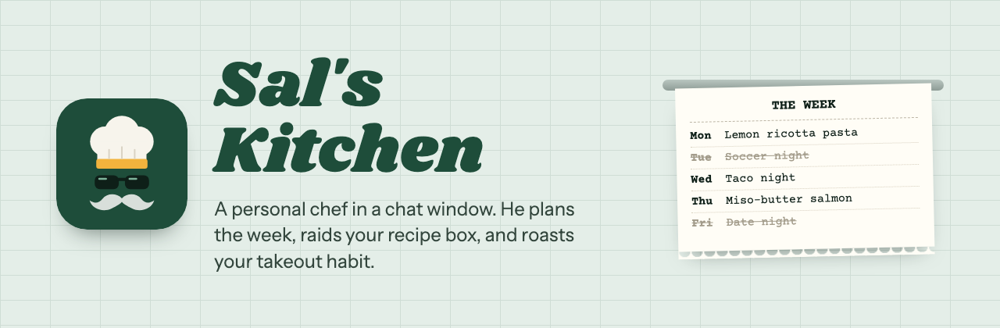
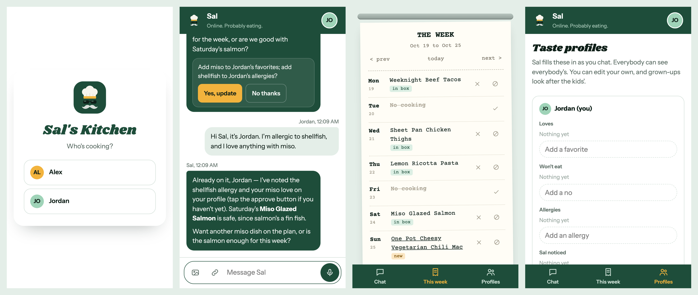
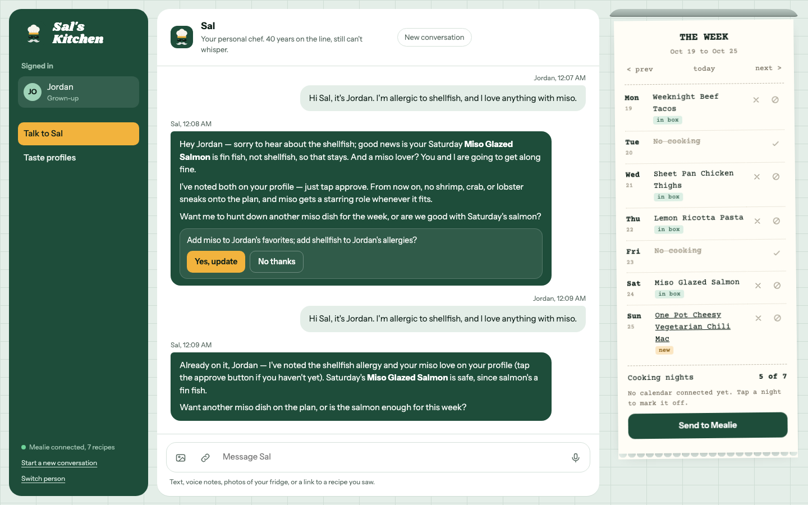

<p align="center">
  
</p>

# Sal's Kitchen

Sal is a personal chef who lives in a chat window. He's an older guy, he's been cooking forever, and he's funny about it. You tell him what kind of week you're having. He checks the family calendar, works out which nights anyone can cook, and fills those nights with meals the household will eat. Then the plan goes to [Mealie](https://mealie.io), the self-hosted recipe manager we already use.

The goal is simple. We want to cook at home more, and planning was always the part that killed it.

<p align="center">
  
</p>

## What Sal does

**Plans the week.** The week is a kitchen ticket next to the chat. Sal reads a shared calendar and crosses off busy evenings (practice, date night, travel). He fills the rest with meals and writes them straight onto the ticket. Anyone can flip a night on or off, or clear a dish, with one tap. When it looks right, a grown-up taps "Send to Mealie" and each night becomes a dinner on Mealie's meal plan. Sending again replaces those dinners instead of duplicating them.

**Writes the grocery list.** Once dinners are on the ticket, tap "Make the grocery list" (or ask Sal). He reads every recipe left this week, scales each one to the number of people eating, and combines what they share, so two recipes with lemons become one line. Amounts come out the way a store sells them. Salt, pepper, cooking oil, and anything on the kitchen list stay off. The list goes into Mealie's shopping lists, sorted by aisle. Making it again replaces it, and anything you already checked off stays checked.

**Knows what's in the kitchen.** The household shares a kitchen list. Tell Sal you bought chicken thighs, or send him a photo of the fridge, and he adds them. He plans around what's there, so the spinach gets used before it turns.

**Asks how dinner went.** The day after a planned dinner, the chat asks each person how it was: loved it, it was fine, not again, or didn't make it. One tap marks the recipe made in Mealie, rates it (the family's average), and adds a note to its timeline. Sal hears the answer too. A hit can go on someone's favorites, and a "not again" gets one question about what went wrong. Past nights on the ticket show what everyone said.

**Starts with your recipe box.** Mealie is the source of truth for recipes. Sal searches it first, because a recipe you've already made once is the one you'll make again. He also checks recent dinners so he doesn't repeat last week.

**Finds new things on the web.** Ask for something new and Sal searches the web, reads the recipe page, and pitches one or two with a link. He only pitches pages that actually contain a recipe, so roundup posts get skipped. If you like one, he asks to save it into Mealie with its photo. He also saves recipes from a photo of a recipe card or cookbook page, or from a recipe someone pasted into the chat. Every saved recipe gets tags (main ingredient, cuisine, and things like Weeknight or Slow cooker) that match the ones already in your box. Recipe blogs without structured data, and sites that block bots, work too. See [reading recipes from the web](docs/architecture.md#reading-recipes-from-the-web).

**Learns what everyone likes.** Each person has a taste profile: favorites, won't-eat, allergies, and things Sal noticed. Sal fills it in from conversation. Everyone can see everyone's profile. You edit your own, and grown-ups look after the kids'. Allergies and won't-eats are hard rules for the planner.

**Remembers each of you, separately.** Sal keeps a private memory for each person: your schedule, your goals, what's in your kitchen. Long conversations get summarized so he keeps the thread without rereading everything. You can see and delete what he remembers about you on the Profiles screen, and nobody else can see it.

**Puts a recipe card in your hand.** Tap a dinner on the ticket, or a recipe link in the chat, and the recipe opens in the app. Change the servings and the amounts follow. Tick off ingredients as they go in, tap steps as you finish them, and tap any time in a step ("simmer 20 minutes") to start a timer. "Keep screen on" stops the phone from dimming with flour on your hands.

**Keeps everyone in step.** Each person talks to Sal privately, but the kitchen log on the week screen shows what everyone did: who planned what, who made the list, how dinners went. Sal reads it too, so he'll tell you Jordan already put tacos on Thursday.

**Asks before changing anything that matters.** Saving a recipe to Mealie, making the grocery list, and changing a profile show an approve button in the chat. Nothing runs until a person taps it. The week ticket is a draft, so Sal edits it freely.

## Talking to him

- Text
- Voice notes. Tap the mic, talk, tap again. It gets transcribed and Sal answers
- Links. Paste a recipe URL and Sal reads it
- Photos. Your fridge, a cookbook page, a dish you had out. A vision model describes the photo (or copies out the recipe word for word) and Sal works from that

He can talk back. Tap the speaker next to a reply to hear it in his voice, or have him read every reply after you send a voice note. If he's going on too long, the send button turns into Stop while he's talking.

He talks like a guy who's run a kitchen for forty years and has stories about most of it. He keeps it short, because you're usually reading him in a grocery store. Persona notes are in [`docs/chef-persona.md`](docs/chef-persona.md).

<p align="center">
  
</p>

## On your phone

It's built phone-first and installs like an app. Open it in Safari or Chrome, tap your avatar, then "Add Sal to your home screen". It opens full screen with its own icon, and there are long-press shortcuts for Chat and This week. If your connection drops mid-reply, the app catches up when you're back. A message that didn't send stays in the box.

Once it's on your home screen, Settings can turn on reminders: a heads-up about tonight's dinner at a time you pick, a nudge the evening before when tomorrow's recipe needs thawing or marinating, and a Sunday morning poke when next week's ticket is empty. On iPhone, reminders only work from the home-screen app. Settings is also where you change your PIN, add someone to the household, and pick light or dark (it follows your phone unless you choose). Starting a new conversation doesn't lose the old one; earlier conversations are listed, searchable, and only visible to you.

## How it works

```
 phone or laptop
        |
        v
 Next.js app  ----->  chat model (OpenAI-compatible API, tool calling)
   |  PIN login        tools: search_recipes, get_recipe, recent_dinners,
   |  chat (SSE)              get_week, plan_nights, web_search, read_link,
   |  week ticket             import_recipe_url*, save_recipe_from_chat*,
   |  profiles                make_grocery_list*, update_profile*,
   |  reminders               update_pantry, log_dinner, remember, forget
   |                   (* waits for a person to approve)
   |
   +--> Mealie REST API   recipes, meal plans, shopping lists, ratings
   +--> ICS calendar feed busy evenings
   +--> web push          reminders to installed phones
   +--> SQLite            people, sessions, profiles, chat, week drafts,
                          kitchen list, dinner feedback, household log
```

Each message runs a tool-calling loop. The model decides when to search the box, check the week, or write to the ticket. The server runs those tools and streams Sal's reply back as it's written. Tool calls and results are saved with the conversation, so Sal remembers what he looked up last turn.

More detail is in [`docs/architecture.md`](docs/architecture.md).

## Running it

You need a Mealie instance, a Mealie API token (Mealie > your profile > API Tokens), and an API key for an OpenAI-compatible provider. It was built against [NanoGPT](https://nano-gpt.com), which also covers web search, speech-to-text, and Sal's voice.

```sh
cd web
cp ../.env.example .env.local   # fill it in
npm install
npm run dev
```

Open the app. The first visit goes to a setup page where you add the household: grown-ups with a 4-digit PIN, kids without one.

### Docker

```sh
cd web
docker build -t sals-kitchen .
docker run -p 3000:3000 -v sal-data:/data --env-file .env.local sals-kitchen
```

The SQLite database and uploaded photos live in `/data`. `GET /api/health` is there for probes.

## Configuration

| Variable | What it's for |
|---|---|
| `LLM_BASE_URL`, `LLM_API_KEY` | OpenAI-compatible endpoint and key |
| `LLM_MODEL` | Chat model. Must handle tool calls well. Default `z-ai/glm-5.3` |
| `VISION_MODEL` | Reads photos. Default `moonshotai/kimi-k2.6` |
| `NANOGPT_API_URL`, `STT_MODEL` | Web search and voice transcription. Default `Whisper-Large-V3` |
| `MEALIE_URL`, `MEALIE_API_TOKEN` | Where the app reaches Mealie (an internal address is fine) |
| `MEALIE_PUBLIC_URL` | Mealie's public address, for recipe links |
| `CALENDAR_ICS_URLS` | Comma-separated ICS feeds. A Google Calendar "secret address in iCal format" works |
| `EVENING_START_HOUR`, `EVENING_END_HOUR` | An event overlapping this window marks the night busy. Default 17 to 20 |
| `TTS_MODEL`, `TTS_VOICE`, `TTS_INSTRUCTIONS` | Sal's speaking voice. Default `gpt-4o-mini-tts` with the `onyx` voice, told to sound like a retired chef |
| `HOUSEHOLD_SIZE` | How many people dinner is for, when scaling grocery lists. Default: everyone in the household |
| `VAPID_PUBLIC_KEY`, `VAPID_PRIVATE_KEY` | Keys for reminders. Make a pair with `npx web-push generate-vapid-keys`. Reminders stay off without them |
| `APP_URL` | The app's public https address. Push services need it to accept reminders |
| `TZ` | Household time zone |
| `SETUP_TOKEN` | If set, the setup page only works from `/setup?token=...`. Set it on any public deployment |
| `DATA_DIR` | Where SQLite and photos go. Default `./data` |

All-day events only block a night when they look like being away (trip, vacation, travel, camping). Add `#nocook` to any event title to block that evening on purpose.

### Picking a model

I ran the same planning conversation through a few models. GLM 5.3 did everything right: it put the meals on the ticket with linked recipes, marked busy nights off, saved the profile change, and placed the web find on the night asked for. Kimi K2.6 was faster but sometimes described a plan without writing it, and once leaked its tool call as raw text. The agent now parses that leak, but GLM is the default. GLM 5.3 doesn't take images, so photos go through a separate vision model first.

## Security notes

- Logins are per person with a 4-digit PIN. Five misses lock that person out, and each lockout doubles (5 minutes, 10, 20, up to a day). Lockouts survive restarts.
- Sessions are random tokens in an httpOnly cookie, valid for 180 days.
- The link reader refuses private and loopback addresses, so a pasted link or a search result can't make the server fetch things on your home network.
- Web pages and search results go to the model as reference material, and anything with side effects waits for a person to approve it.
- Photos, memories, and conversations are private to the person they belong to. The service worker never caches API responses, so chats don't sit on the device.
- While web text is in a conversation, anything Sal would write on someone's behalf (a memory, the kitchen list, how a dinner went) shows an approve button first, so a recipe page can't plant instructions.
- Reminders only go to the browsers' own push services (Apple, Google, Mozilla, Microsoft), so a sign-up can't point the server at another address.
- Changing a PIN needs the current one, and wrong guesses count toward the same lockout as logging in.

## Repo layout

```
web/          the app (Next.js, TypeScript, SQLite)
assets/       icon, home-screen icons, banner (banner.html is the source)
docs/         architecture, chef persona, screenshots
prototype/    the original static UI mock
```

## License

MIT
